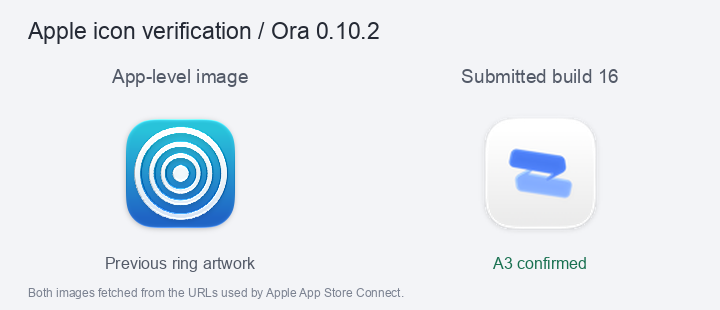

# Ora 0.10.2 (16): Apple icon audit

**The submitted build uses A3, and Apple extracted A3 correctly.** The old icon in the app-level header/list is a different image reference from the icon associated with build 16. This is a verified display/reference distinction, not a claim about browser caching or a promised refresh time.

## Evidence

1. Inspected the actual **Build 16 App Icon** element on the version page. Its Apple CDN URL returns `build16.png`, showing A3.
2. Inspected the **app-level header image**. Its different CDN URL returns `app-level.png`, showing the previous rings.
3. Recovered the actual Xcode upload package from the upload pipeline path recorded in distribution logs. Package size: **40,743,872 bytes**; SHA-256: `337d40aa079e3f34fcf3489c625f841e069ffe13c442338eb4b5db0e65ca0c11`.
4. Expanded that exact package. Its Info.plist identifies `com.wangzhangwu.ora`, version `0.10.2`, build `16`. Both `AppIcon.icns` and `Assets.car` match the approved archive byte-for-byte. Native catalog inspection includes 1024-pixel icon renditions.
5. Apple's build metadata identifies build 16 as Validated. The existing review submission is for 0.10.2 (16).

The package and expanded payload remain local, outside git. `verification.json` records the exact image URLs, hashes and comparisons.

## Decision

No packaging fault or Apple extraction fault was reproduced. The current build was not withdrawn or replaced. The app-level old image remains an Apple backend display observation; the public storefront icon cannot be verified before the pending release becomes available.

For future submissions, inspect the icon associated with the numbered build; the app-level header/list alone does not establish which icon a submitted binary contains.
